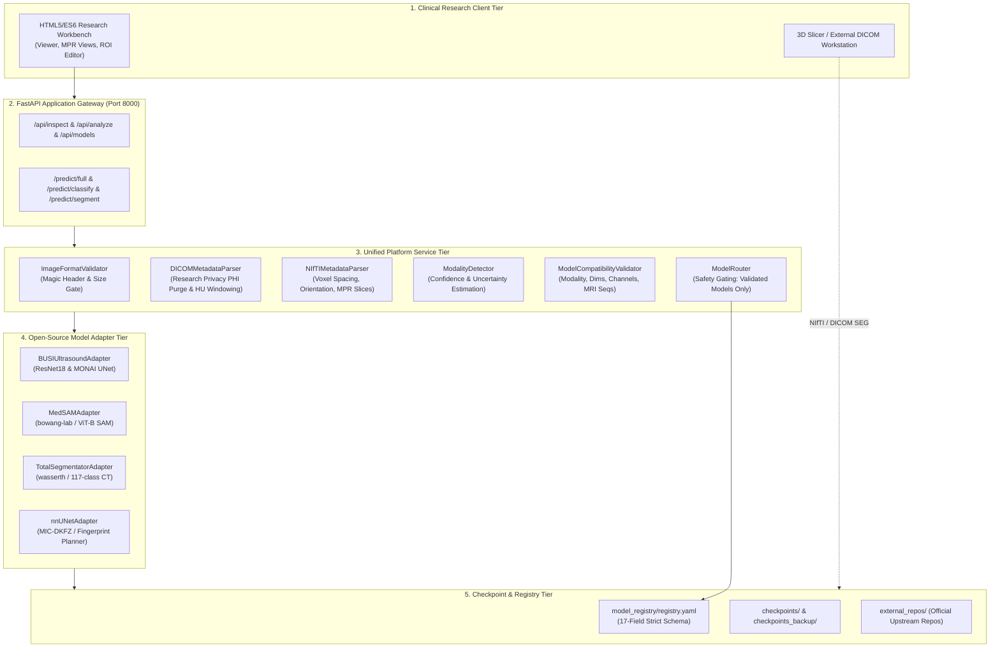

# MURL Unified Multi-Modal Medical AI Platform — System Architecture

## 1. Architectural Philosophy

The MURL Medical AI Platform expands the verified Breast Ultrasound AI Workbench into a unified, modular, multi-modal clinical research platform.
In adherence to modular engineering principles ("do not build everything from scratch"), the platform achieves maximum legitimate code reuse by integrating authoritative open-source medical AI systems:
- **Project-MONAI / MONAI:** Deep medical transforms, 2D/3D U-Net backbones, sliding window inference.
- **bowang-lab / MedSAM:** ViT-B prompt-based universal medical segmentation engine.
- **wasserth / TotalSegmentator:** 117-class CT anatomical segmentation and automated body-crop heuristics.
- **MIC-DKFZ / nnU-Net:** Automated self-configuring heuristic planning and voxel geometry fingerprinting.
- **Project-MONAI / MONAI Label:** Active learning schema and RESTful annotation task contracts.
- **3D Slicer:** Volumetric multi-planar visualization standards and file export bridge.

---

## 2. Multi-Tier System Topology

---

## 3. Component Specifications

### 3.1 Input Format & Privacy Layer
- **`ImageFormatValidator`** ([`src/platform/format_validator.py`](src/platform/format_validator.py)): Inspects file headers (PNG, JPEG, DICOM `DICM`, NIfTI gzip `\x1f\x8b`, uncompressed 348-byte headers). Enforces 50 MB / 250 MB size bounds.
- **`DICOMMetadataParser`** ([`src/platform/dicom_parser.py`](src/platform/dicom_parser.py)): Extracts technical tags while purging 16 PHI tags for research privacy. Handles windowing and multi-frame volumes.
- **`NIfTIMetadataParser`** ([`src/platform/volume_parser.py`](src/platform/volume_parser.py)): Extracts 3D/4D voxel spacing, anatomical orientation (RAS/LPS), and renders orthogonal slices (axial, coronal, sagittal).
- **`ModalityDetector`** ([`src/platform/modality_detector.py`](src/platform/modality_detector.py)): Evaluates DICOM tags with 100% confidence. For rasters, returns uncertainty and requires user confirmation. Strictly never infers diagnoses from filenames.

### 3.2 Registry & Routing Layer
- **`ModelRegistry`** ([`src/platform/registry.py`](src/platform/registry.py)): Enforces a 17-field schema. Blocks automated dispatch of unvalidated models.
- **`ModelCompatibilityValidator`** ([`src/platform/compatibility_validator.py`](src/platform/compatibility_validator.py)): Prevents cross-modality data passing, shape mismatches (2D vs. 3D), and incomplete MRI sequence sets.
- **`ModelRouter`** ([`src/platform/router.py`](src/platform/router.py)): Connects compatible requests to instantiated adapters.

### 3.3 Upstream Adapter Layer
- **`BUSIUltrasoundAdapter`** ([`src/platform/adapters/busi_ultrasound.py`](src/platform/adapters/busi_ultrasound.py)): Reuses verified ResNet18 and MONAI U-Net weights.
- **`MedSAMAdapter`** ([`src/platform/adapters/medsam_adapter.py`](src/platform/adapters/medsam_adapter.py)): Reuses `segment_anything` ViT-B prompt encoder/decoder from `external_repos/MedSAM`.
- **`TotalSegmentatorAdapter`** ([`src/platform/adapters/totalsegmentator_adapter.py`](src/platform/adapters/totalsegmentator_adapter.py)): Reuses CT body cropping, HU windowing, and 117-organ class mapping from `external_repos/TotalSegmentator`.
- **`nnUNetAdapter`** ([`src/platform/adapters/nnunet_adapter.py`](src/platform/adapters/nnunet_adapter.py)): Reuses heuristic fingerprint planning and spacing normalization from `external_repos/nnUNet`.
