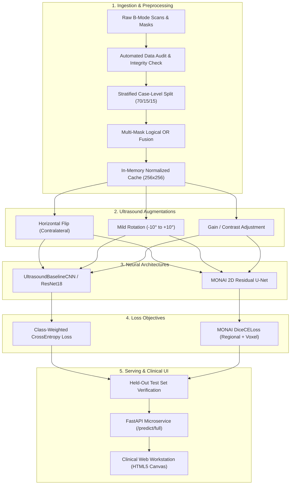

# Project Architecture & Modular Design

## 1. System Overview

This repository provides a modular, production-grade deep learning engineering platform designed for translational medical ultrasound and multi-modal imaging research.

The system features:
1. **Multi-Task Clinical Pipeline:** Joint multi-class ultrasound classification and pixel-level lesion boundary segmentation.
2. **Project-MONAI Foundation:** Native adoption of Project MONAI's specialized medical imaging architectures and objective functions (`monai.networks.nets.UNet`, `monai.losses.DiceCELoss`, `monai.utils.set_determinism`).
3. **Leak-Free Data Partitioning:** Case-level atomic splitting guaranteeing zero patient overlap across training, validation, and held-out test splits.
4. **Deterministic Reproducibility:** End-to-end seed synchronization across Python, NumPy, PyTorch, CUDA, and MONAI.
5. **RESTful Service & Interactive Workbench:** Low-latency FastAPI microservice serving real-time predictions to an interactive HTML5 medical workstation.

---

## 2. Directory Architecture

```
Ai Medical/
├── configs/                          # Experiment configuration files
│   ├── classification_config.yaml    # Hyperparameters for baseline & transfer classifiers
│   └── segmentation_config.yaml      # Architecture & loss specs for MONAI U-Net
├── data/
│   ├── raw/
│   │   └── Dataset_BUSI_with_GT/     # Original uncorrupted BUSI scans & masks
│   └── processed/
│       └── dataset_metadata.json     # Audited case metadata, dimensions, and split tags
├── src/
│   ├── dataset.py                    # PyTorch/MONAI Datasets with in-memory caching & mask fusion
│   ├── data_audit.py                 # Automated integrity, dimension, and duplicate audit
│   ├── detection_investigation.py    # Phase 5 bounding box investigation & provenance study
│   ├── models/
│   │   ├── classification.py         # UltrasoundBaselineCNN & UltrasoundTransferClassifier (ResNet18)
│   │   └── segmentation.py           # UltrasoundUNet (MONAI 2D Residual U-Net)
│   ├── training/
│   │   ├── train_classifier.py       # Classification training loop with class-weighted loss
│   │   └── train_segmentor.py        # Segmentation training loop with MONAI DiceCELoss
│   ├── evaluation/
│   │   ├── metrics.py                # Dice, IoU, Accuracy, Macro/Weighted F1, ROC-AUC, CM
│   │   └── evaluate.py               # Rigorous test-set evaluation & publication figure generation
│   ├── inference/
│   │   └── predictor.py              # Unified multi-task predictor with bounding box extraction
│   └── utils/
│       └── seed.py                   # Global determinism & CPU/GPU device selection
├── api/
│   ├── app.py                        # FastAPI REST API with lifespan-managed predictor
│   ├── schemas.py                    # Pydantic v2 validation models
│   └── static/
│       └── index.html                # Interactive medical ultrasound analysis web workstation
├── tests/                            # Automated test suite (PyTest)
│   ├── test_dataset.py               # Mask binarization, case loading, class weights
│   ├── test_models.py                # Forward passes, output tensor shapes, gradients
│   ├── test_pipeline.py              # Empty mask Dice handling, reproducibility, device fallback
│   └── test_api.py                   # REST endpoint status codes and payload schema validation
├── checkpoints/                      # Serialized model weights (.pth) & training logs (.json)
├── outputs/
│   ├── figures/                      # High-resolution ROC curves, confusion matrices, overlays
│   ├── test_evaluation_report.json   # Verified held-out test evaluation results
│   └── detection_investigation_report.json
├── requirements.txt                  # Pinned dependency manifest
└── README.md                         # Project documentation and execution guide
```

---

## 3. End-to-End Pipeline Data Flow

The following Mermaid flowchart illustrates the end-to-end data lifecycle from raw ultrasound ingestion to web demonstration:



---

## 4. Key Architectural Design Choices

1. **In-Memory Cache Layer (`src/dataset.py`):**
   Ultrasound scans vary between 190 to 1048 pixels. Reading raw PNG files and performing PIL geometric transforms at native resolution on CPU caused an I/O bottleneck (~70s/epoch). By resizing once to standard dimensions ($256 \times 256$) during dataset initialization and maintaining the PIL images in memory (~50MB RAM footprint), epoch throughput accelerated dramatically while preserving ultrasound texture features.

2. **MONAI Residual U-Net Integration (`src/models/segmentation.py`):**
   Unlike standard computer vision segmentation models that ignore medical imaging topology, MONAI's `UNet` includes residual skip connections (`num_res_units=2`) that prevent vanishing gradients across deep stages and preserve high-frequency acoustic shadow margins.

3. **Loss Function Engineering:**
   - **Classification:** Inverse frequency weighting in `CrossEntropyLoss` directly prevents gradient starvation for the minority malignant (26.9%) and normal (17.0%) cohorts.
   - **Segmentation:** `DiceCELoss` combines the global boundary overlap optimization of Sørensen-Dice with the smooth pixel-level cross-entropy gradient, avoiding local minima on small, irregular lesions.
