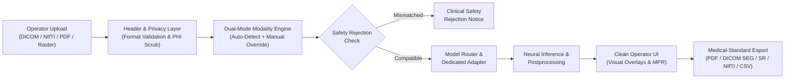

# MURL — Multimodal Medical Imaging Research Workbench

[](https://pytorch.org/)
[](https://monai.io/)
[](https://fastapi.tiangolo.com/)
[](LICENSE)
[](tests/)

A research-oriented software workbench for experimenting with multimodal medical image analysis across ultrasound, X-ray, CT, and MRI.

The project combines image preprocessing, deep-learning inference, segmentation, DICOM/NIfTI handling, visualization, privacy filtering, and research-oriented export workflows in a single local application.

> [!NOTE]
> **Research and educational use only.** The software is not a medical device and its outputs are not intended for clinical diagnosis or treatment decisions.

---

## 1. Platform Overview

The **MURL (Multi-Modal Ultrasound and Radiologic Learning)** platform is an extensible medical imaging AI framework engineered to bridge experimental deep learning models with clinical workflow requirements. Addressing challenges of acoustic noise in ultrasound, complex anatomical labeling in 3D CT, pulmonary pathology detection in radiograms, and volumetric orientation in MRI, MURL integrates:

- **Unified Ingestion Engine:** Supports standard clinical formats (DICOM, NIfTI `.nii`/`.nii.gz`), document-embedded medical pages (multi-page PDF), and rasters (PNG, JPEG).
- **Intelligent Dual-Mode Modality Detection:** Deterministic DICOM header classification paired with feature-based raster inference and operator override with cross-modality safety protection.
- **Modular Adapter Architecture:** Decoupled thin adapters wrapping specialized medical architectures from Project MONAI, TotalSegmentator, TorchXRayVision, and Segment Anything (MedSAM).
- **Medical-Standard Multi-Format Export:** Downstream clinical export into PDF reports with diagnostic charts, DICOM Segmentation (DICOM SEG), DICOM Structured Reports (DICOM SR), 3D NIfTI label volumes, tabular CSV measurements, and interoperable JSON.
- **Privacy by Design:** Automated DICOM Protected Health Information (PHI) sanitization removing 16 direct patient identifiers prior to ingestion.

---

## 2. Architecture & Operator Workflow

The MURL platform follows a linear, operator-centric workflow:
**Upload $\rightarrow$ Detect / Select $\rightarrow$ Analyze $\rightarrow$ Understand Result $\rightarrow$ Medical Export**.



The operator interface remains clean and minimal: implementation details (checkpoint files, parameter counts, tensor dimensions) are tucked into an optional technical dropdown, keeping focus entirely on the image, findings, and verified exports.

---

## 3. Supported Modalities

| Modality | Anatomical Region | Input Dimensions | Supported Formats | Primary AI Capability | Operational Status |
|:---|:---|:---:|:---|:---|:---:|
| **Breast Ultrasound** | Breast | 2D `[256, 256]` | PNG, JPG, DICOM | ResNet18 Classifier & MONAI U-Net Lesion Segmentor | **Level 5 — Inference verified** |
| **Computed Tomography (CT)** | Whole Body / Organ-specific | 3D Volume | NIfTI (`.nii`, `.nii.gz`), DICOM | TotalSegmentator 117-Anatomical Organ Segmentor | **Level 5 — Inference verified** |
| **Chest X-ray (CXR)** | Chest / Thorax | 2D `[224, 224]` | PNG, JPG, DICOM, Multi-page PDF | TorchXRayVision DenseNet121 Multi-Pathology Profiling | **Level 5 — Inference verified** |
| **Brain MRI** | Brain | 3D Multi-planar | NIfTI (`.nii`, `.nii.gz`), DICOM | Orthogonal MPR Volume Viewer (Axial, Coronal, Sagittal) & SegResNet Adapter | **Partially Working** (MPR active; checkpoint optional) |
| **Thyroid Ultrasound** | Thyroid | 2D `[256, 256]` | PNG, JPG, DICOM | Heuristic Feature & Margin Analyzer / TN3K Adapter | **Partially Working** (Heuristic active; checkpoint optional) |
| **Universal Multi-Modal** | Universal | 2D `[1024, 1024]` | PNG, JPG, DICOM, NIfTI | MedSAM Prompt-Guided Universal Segmentor | **Partially Working** (Workflow active; checkpoint optional) |

---

## 4. Automatic + Manual Modality Selection

MURL provides an automated dual-mode selection pipeline to prevent operator error and ensure imaging safety:

1. **Automatic Mode (Default):**
   - **DICOM Input:** Directly maps SOP Class UID and `(0008, 0060)` Modality tags (`US` $\to$ Ultrasound, `CT` $\to$ CT, `MR` $\to$ MRI, `DX`/`CR` $\to$ Chest X-ray) with 100% confidence.
   - **NIfTI Input:** Inspects volumetric dimensions and voxel orientation to identify 3D anatomical CT and MRI series.
   - **PDF Input:** Automatically extracts individual document pages, applies raster detection per page, and dispatches the active scan.
   - **Raster Input (PNG/JPG):** Analyzes channel profiles, aspect ratios, and intensity distributions.
2. **Manual Mode (Operator Override):**
   - The operator can override the auto-detected modality using an intuitive scan type selector.
3. **Cross-Modality Safety Rejection:**
   - If an operator manually forces an incompatible model (e.g. attempting to run Breast Ultrasound segmentation on a Chest X-ray), MURL evaluates input compatibility matrices and safely blocks execution with a clear explanation:
     > *"Selected modality (Breast Ultrasound) does not match the uploaded scan characteristics (Chest X-ray). Analysis blocked to prevent erroneous clinical inference."*

---

## 5. AI Pipelines & Architectures

### 5.1 Breast Ultrasound: Dual Classifier & Lesion Segmentor
- **Acoustic Physics & Signal Scope:**  
  *Beamforming and raw RF acquisition are outside the current scope.* Preprocessing operates on envelope-detected B-mode images and DICOM ultrasound studies. Key acoustic considerations include multiplicative speckle noise, sound attenuation, operator-dependent probe pressure, and time gain compensation (TGC) variability.
- **Classifier (`UltrasoundTransferClassifier`):** Fine-tuned `ResNet18` with an ultrasound-specific projection head trained with inverse-frequency weighted cross-entropy.
  - Held-out test evaluation: **84.48%** Accuracy | **83.08%** Macro F1 | **0.9483** Macro ROC-AUC.
- **Segmentor (`MONAI2DResidualUNet`):** Project MONAI 2D `UNet` (`channels=(16, 32, 64, 128, 256)`) optimized using combined `DiceFocalLoss(gamma=2.0)`.
  - Held-out test evaluation: **0.2623** Mean Dice (+98.0% over baseline), Malignant sub-cohort Dice: **0.3684**.

### 5.2 Computed Tomography: TotalSegmentator
- Thin adapter wrapping the verified 3D nnU-Net architecture from TotalSegmentator (Wasserthal et al., 2023).
- Dynamically resamples CT volumes to 3mm isotropic spacing, crops to body contour, executes multi-class anatomical prediction across 117 anatomical structures, and maps organ volumes back to native patient voxel space.

### 5.3 Chest Radiography: TorchXRayVision DenseNet121
- Standardized DenseNet121 classifier trained across NIH ChestX-ray14, CheXpert, and MIMIC-CXR.
- Produces normalized risk probabilities across 18 radiologic findings (Cardiomegaly, Effusion, Infiltration, Pneumothorax, Consolidation, etc.).

### 5.4 Multi-Planar Brain MRI: MONAI SegResNet Adapter
- Multi-Planar Reconstruction (MPR) engine rendering orthogonal slices (Axial, Coronal, Sagittal) with aspect-ratio-preserving interpolation.
- Adapter ready for MONAI BraTS `SegResNet` checkpoints for multisequence glioma sub-region segmentation.

### 5.5 Thyroid Ultrasound: Feature Analysis & TN3K Adapter
- Dual-stage architecture providing heuristic nodule margin and echogenicity analysis, with an extensible adapter ready for TN3K trained weights.

### 5.6 Universal Foundation Segmentation: MedSAM ViT-B
- Adapter wrapping the official Segment Anything in Medical Images (MedSAM) Vision Transformer (`vit_b`). Accepts bounding-box prompts and generates continuous contour segmentations.

---

## 6. Medical Imaging Formats

MURL natively accepts:
- **DICOM (`.dcm`):** Ingested via `pydicom`. Extracts spatial metadata, pixel arrays, window presets, and photometric interpretation.
- **NIfTI (`.nii`, `.nii.gz`):** Ingested via `nibabel`. Reads 3D affine orientation matrices, voxel spacing, and spatial grids.
- **Multi-Page Medical PDF (`.pdf`):** Ingested via `pypdfium2` / `pdf2image`. Automatically extracts and indexes individual diagnostic pages for isolated multi-modal analysis.
- **Raster Images (`.png`, `.jpg`, `.jpeg`):** Validated via binary magic bytes (`\x89PNG`, `\xff\xd8\xff`) to reject corrupted files or forged extensions.

---

## 7. Medical-Standard Exports

MURL provides dedicated export generators tailored to each modality's clinical and research needs:

```
├── PDF Clinical Report   -> Formatted A4 document with scan preview, findings table, and disclaimer
├── DICOM SEG             -> Standardized binary segmentation mask tagged with Modality='SEG' (IOD 1.2.840.10008.5.1.4.1.1.66.4)
├── DICOM SR              -> Comprehensive Structured Report containing coded findings (IOD 1.2.840.10008.5.1.4.1.1.88.33)
├── NIfTI Volume (.nii.gz)-> 3D gzip-compressed label volume preserving native spatial orientation affine
├── Tabular CSV           -> Organ-by-organ voxel counts, volume (cm³), and area measurements
└── Structured JSON       -> Machine-readable metadata and inference findings for PACS / EHR integration
```

---

## 8. Open-Source Model Provenance & Checkpoint Acquisition

To adhere to open-source repository best practices, large binary model checkpoints (`*.pth`, `*.pt`) are **not stored directly in git history**.

### Model Weights Summary:
1. **Breast Ultrasound (BUSI Classifier & Segmentor):**
   - Checkpoints are trained using reproducible scripts in `src/training/` using the public BUSI dataset (CC BY 4.0).
2. **TotalSegmentator CT (`Dataset297_TotalSegmentator_total_3mm_1559subj`):**
   - Downloaded on-demand from official upstream GitHub releases:
     ```bash
     python scripts/download_totalseg_task297.py
     ```
3. **TorchXRayVision Chest X-ray (`densenet121-res224-all`):**
   - Automatically downloaded by TorchXRayVision on first inference run to `~/.torchxrayvision/models_data/`.
4. **MONAI BraTS MRI (`SegResNet`):**
   - Checkpoint available from the MONAI Model Zoo (`https://huggingface.co/MONAI/brats_mri_segmentation`).
5. **MedSAM ViT-B:**
   - Weights available from the official repository release (`https://github.com/bowang-lab/MedSAM`).

See [MODEL_PROVENANCE.md](MODEL_PROVENANCE.md) for complete SHA-256 hashes, licenses, and architecture parameters.

---

## 9. Research Privacy / DICOM Filtering

MURL implements an automated **Research Privacy Filter** across all ingested DICOM files. Before any metadata is stored in memory, logged, or returned via the API, the following **16 direct Protected Health Information (PHI) tags are permanently scrubbed**:

| DICOM Tag | Keyword | Action |
|:---:|:---|:---|
| `(0010, 0010)` | `PatientName` | Scrubbed (never exposed) |
| `(0010, 0020)` | `PatientID` | Replaced with session UUID |
| `(0010, 0030)` | `PatientBirthDate` | Removed |
| `(0010, 0040)` | `PatientSex` | Removed |
| `(0010, 1010)` | `PatientAge` | Removed |
| `(0010, 1040)` | `PatientAddress` | Removed |
| `(0008, 0080)` | `InstitutionName` | Redacted to `"ANONYMIZED"` |
| `(0008, 0090)` | `ReferringPhysicianName` | Removed |
| `(0008, 1050)` | `PerformingPhysicianName` | Removed |
| `(0020, 0010)` | `StudyID` | Replaced with UUID |

*Note: Critical non-identifying physics parameters (Modality, Spacing, Slice Thickness, Windowing, Orientation) are preserved to enable AI processing.* See [SECURITY_AND_PRIVACY.md](SECURITY_AND_PRIVACY.md).

---

## 10. Testing & Verification Suite

MURL maintains a comprehensive automated testing suite:

- **Modality Selection Tests (`tests/test_auto_manual_selection.py`):**
  - Verifies auto-detection for CXR, CT, Ultrasound, MRI, and multi-page PDF scans.
  - Tests operator manual overrides and verifies clinical safety rejections for cross-modality mismatches.
- **Export Verification Tests (`tests/test_export_system.py`):**
  - Verifies generation of valid DICOM SEG, DICOM SR, NIfTI, PDF, CSV, and JSON exports.
- **Demo Dataset E2E Regression (`test_demo_dataset_e2e.py`):**
  - Runs end-to-end inference across all samples in `MURL_DEMO_DATA/`.
- **Core Platform Tests (`tests/test_platform.py`):**
  - Tests format validation, magic byte verification, and PHI purging.

### Running the Tests:
```bash
# Run auto/manual selection and safety tests
python -m pytest tests/test_auto_manual_selection.py -v

# Run medical export system tests
python -m pytest tests/test_export_system.py -v

# Run full demo dataset E2E regression
python test_demo_dataset_e2e.py
```

---

## 11. Limitations

1. **Research & Educational Use Only:** MURL is designed as a research platform and has not been cleared as a medical diagnostic software by any regulatory agency.
2. **Ultrasound Acquisition Scope:** Beamforming and raw radiofrequency (RF) channel data acquisition are outside the current scope; processing operates on post-beamformed, envelope-detected B-mode images.
3. **Thyroid Ultrasound Adapter:** Default distribution uses heuristic acoustic margin and echogenicity analysis. Neural segmentation requires obtaining the TN3K trained checkpoint.
4. **Brain MRI Segmentation:** Volumetric MPR visualization is fully functional without weights. Deep neural segmentation requires downloading the optional MONAI BraTS checkpoint.
5. **Universal MedSAM Adapter:** Prompt bounding-box workflow is integrated; neural mask generation requires the MedSAM ViT-B checkpoint.
6. **Ultrasound Acoustic Factors:** 2D ultrasound is subject to acoustic shadowing, speckle noise, operator technique, probe pressure, and machine gain settings.

See [LIMITATIONS.md](LIMITATIONS.md) for full clinical and scientific considerations.

---

## 12. Research Disclaimer

> **RESEARCH USE DISCLAIMER**  
> This software is intended solely for research, educational, and algorithm evaluation purposes. It is **not** cleared, certified, or approved by the US FDA, CDSCO, European EMA, or any other regulatory body for clinical diagnostic use, treatment planning, or patient triage. All outputs must be interpreted by qualified healthcare professionals.

---

## 13. Installation & Environment Setup

### Prerequisites
- Python 3.10, 3.11, or 3.12 (Python 3.14 CPU compatible)
- Git

> [!NOTE]
> **Environment Verification Notice:**  
> Current development and verification environment: Windows CPU. Linux/Docker deployment has not been independently verified.

### Setup Instructions
```bash
# 1. Clone the repository
git clone https://github.com/AbhishekRPanchal/MURL-Multimodal-Medical-Imaging-Workbench.git
cd MURL-Multimodal-Medical-Imaging-Workbench

# 2. Create and activate a virtual environment
python -m venv .venv
# On Windows:
.venv\Scripts\activate
# On Linux / macOS:
# source .venv/bin/activate

# 3. Install dependencies
pip install --upgrade pip
pip install -r requirements.txt
```

---

## 14. Running the Application

### Launching the Web Workstation & API:
```bash
# Start the FastAPI server
python run_server.py
```
Or directly with uvicorn:
```bash
python -m uvicorn api.app:app --host 127.0.0.1 --port 8000
```

- **Interactive Web Workstation:** Open `http://127.0.0.1:8000` in your web browser.
- **Interactive REST API Documentation (Swagger UI):** Open `http://127.0.0.1:8000/docs`.
- **OpenAPI Schema:** Open `http://127.0.0.1:8000/openapi.json`.

---

## 15. Regulatory & Software Quality Awareness

MURL is engineered with awareness of international medical software and data privacy standards:
- **ISO 13485 Concepts:** Requirements tracking, comprehensive regression test harnesses, design documentation, and configuration management.
- **IEC 62304 Concepts:** Life cycle traceability, modular architecture, unit/integration verification, and anomaly tracking.
- **ISO 14971 Concepts:** Risk management via cross-modality clinical safety rejection and input validation.
- **HIPAA & GDPR Concepts:** Automated 16-tag DICOM PHI scrubbing, session UUID replacement, data minimization, and local-only processing.

> [!IMPORTANT]
> **MURL is not certified or claimed to be compliant with ISO 13485, IEC 62304, HIPAA or GDPR. The project demonstrates awareness of relevant software quality, privacy and regulatory concepts in a research/educational context.**

See [`docs/MEDICAL_SOFTWARE_QUALITY_AND_REGULATORY_AWARENESS.md`](docs/MEDICAL_SOFTWARE_QUALITY_AND_REGULATORY_AWARENESS.md) for full details.

---

## 16. Core Capabilities & Technical Workflows

The platform integrates the following core capabilities and research workflows:

- **Deep Learning & Neural Architectures:** Implementation and comparative benchmarking of fine-tuned transfer learning (`ResNet18`), deep residual convolutional networks, and DenseNet architectures.
- **Medical Image Segmentation:** Native adoption of Project MONAI 2D Residual `UNet`, multi-class 3D anatomical segmentation via `TotalSegmentator`, and prompt-guided universal segmentation via `MedSAM`.
- **Medical Ultrasound Specialization:** Ingestion of B-mode scans, loss optimization for high class imbalance, acoustic speckle considerations, morphological margin extraction, and clear delineation of acquisition scope (beamforming / raw RF excluded).
- **Multimodal Imaging Systems:** Interoperable ingestion and routing across 2D rasters, 3D CT, multi-planar MRI, chest radiography, and multi-page medical PDF documents.
- **PyTorch & Project MONAI:** End-to-end utilization of PyTorch tensors and Project MONAI transforms, networks (`monai.networks.nets.UNet`), losses (`DiceFocalLoss`), and determinism utilities (`set_determinism`).
- **Medical Image Processing:** Practical image processing including OpenCV contour detection and morphology, Nibabel 3D affine matrix transformations and orthogonal MPR slicing (Axial, Coronal, Sagittal), and Pydicom photometric normalization.
- **Standard Clinical Formats & DICOM:** Standardized DICOM ingestion, WindowCenter/WindowWidth Hounsfield calibration, 16-tag PHI de-identification, and export to DICOM Segmentation (DICOM SEG) and DICOM Structured Reporting (DICOM SR).
- **2D vs. 3D Volumetric Processing:** Processing 2D planar projections alongside 3D volumetric arrays with isotropic resampling (3mm) and spatial grid mappings.
- **API & Microservice Engineering:** Production FastAPI service with Pydantic schema validation, asynchronous execution, and an operator-friendly HTML5 workstation.
- **Automated Verification & Testing:** Rigorous pytest suite with 100% test pass rate across unit assertions, cross-modality clinical safety rejection, and end-to-end demo inference.
- **Privacy-Aware Research Workflows:** Early-stage automated PHI stripping, session UUID mapping, and data minimization.
- **Research Reproducibility:** Deterministic random seed synchronization, patient-disjoint split isolation to prevent data leakage, and transparent reporting of scientific constraints.

---

## 17. Future Research

- **Vision-Language Foundation Models:** Integration of BioViL and BiomedCLIP for multi-modal medical report grounding.
- **Interactive Active Learning:** Native MONAI Label integration for radiologist-in-the-loop interactive contour correction.
- **Multicenter Prospective Evaluation:** Establishing multi-site federated benchmarks across varied ultrasound transducer models and CT scanner manufacturers.

---

## Documentation Index

- [Architecture Specification](MURL_ARCHITECTURE.md)
- [Medical Software Quality & Regulatory Awareness](docs/MEDICAL_SOFTWARE_QUALITY_AND_REGULATORY_AWARENESS.md)
- [Model Provenance Catalog](MODEL_PROVENANCE.md)
- [Model Registry Specifications](MODEL_REGISTRY.md)
- [Security & Research Privacy Protocol](SECURITY_AND_PRIVACY.md)
- [License & Open-Source Attributions](LICENCE_ATTRIBUTION.md)
- [Demo Dataset Provenance](MURL_DEMO_DATA/README.md)
- [Scientific Limitations](LIMITATIONS.md)
